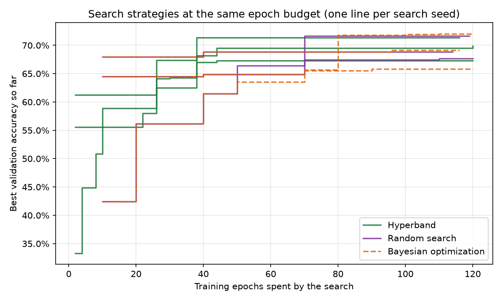

# Hyperparameter Tuning Lab: Keras Tuner on CIFAR-10

This lab tunes a small convolutional network (CNN) for CIFAR-10 photos with [Keras Tuner](https://keras.io/keras_tuner/). It searches the network's depth, filters, kernel size, dense layer, dropout, data augmentation, learning rate and batch size with **Hyperband**, re-checks the search's top configurations with fresh seeds before choosing one, then compares the tuned model with a hand-picked baseline fairly: both trained the same way, with several seeds, on the test set only at the end. A second command compares Keras Tuner's three search strategies (Hyperband, random search and Bayesian optimization) at the same budget of training epochs, and a third checks the one setting the search's short trials can't judge: data augmentation.

It covers:
- a Keras Tuner **`HyperModel`** with **conditional hyperparameters** (each convolution block's filters exist only when the block does), a **log-scale** learning rate, augmentation as an on/off hyperparameter, and the **batch size** tuned in `fit()`
- **Hyperband**, **random search** and **Bayesian optimization**, compared at the same budget of training epochs
- the **winner's curse**: a search's best score can be luck, so its top configurations are re-checked with fresh seeds before one is chosen
- the limits of **short trials**: the search turned augmentation off, and the same network with it on scores about 5 points higher
- a fair comparison with the baseline (same training, 5 seeds, a paired 95% interval) and a search that is **reproducible** and **fails loudly**
- **tests** and a one-command run

It is based on the course's hyperparameter tuning lab (`Labs/Model_Development/Hyper_Parameters_Tuning/Keras_Tuner.ipynb`), kept unchanged in [original/Keras_Tuner.ipynb](original/Keras_Tuner.ipynb), which tunes a dense network on Fashion MNIST. With current packages that notebook doesn't work: every training run crashes, yet it still reports a "tuned" model far better than the baseline. Steps 1 to 6 fixed and extended the lab on Fashion MNIST ([their results](#steps-1-to-6-the-same-lab-on-fashion-mnist) are kept below); step 7 moved it to CIFAR-10 and a CNN. [What changed](#what-changed-from-the-original-lab) lists every change and why.

## Contents

- [Prerequisites](#prerequisites)
- [Setup](#setup)
- [Run the whole lab in one command](#run-the-whole-lab-in-one-command)
- [Run the steps yourself](#run-the-steps-yourself)
- [Check augmentation](#check-augmentation)
- [Compare search strategies](#compare-search-strategies)
- [Results and findings](#results-and-findings)
- [Steps 1 to 6: the same lab on Fashion MNIST](#steps-1-to-6-the-same-lab-on-fashion-mnist)
- [What changed from the original lab](#what-changed-from-the-original-lab)
- [Project layout](#project-layout)
- [Troubleshooting](#troubleshooting)

## Prerequisites

| Requirement | Version tested | Install |
|---|---|---|
| Python | 3.12 (TensorFlow 2.21 supports 3.10 to 3.13, not 3.14) | macOS: `brew install python@3.12`; Ubuntu: `sudo apt install python3.12 python3.12-venv`; Windows: [python.org](https://www.python.org/downloads/) |
| Git | any | macOS: `xcode-select --install`; Ubuntu: `sudo apt install git`; Windows: `winget install Git.Git` |
| bash | any, for `run_lab.sh` | built into macOS and Linux. On Windows, use WSL 2 or Git Bash, or run the steps yourself |

Check Python:

```bash
python3.12 --version
```

This should print `Python 3.12.x`. Python 3.10, 3.11 or 3.13 also work; 3.14 does not, because TensorFlow 2.21 has no packages for it.

Packages, installed from `requirements.txt` by the setup below (or by `run_lab.sh`):

| Package | Version | Used for |
|---|---|---|
| tensorflow | 2.21.0 | training the models |
| keras | 3.15.1 | the model API |
| keras-tuner | 1.4.8 | the hyperparameter search |
| tensorboard | 2.21.0 | training curves. TensorFlow 2.21 no longer installs it, and Keras's TensorBoard callback fails without it |
| scipy / scikit-learn | 1.18.1 / 1.9.1 | Keras Tuner's `BayesianOptimization` (its optional `bayesian` extra), used by the strategy comparison |
| matplotlib | 3.11.2 | the strategy comparison's plot |
| pytest | 9.1.1 | the tests in `tests/` |

Training runs on the CPU; no GPU is needed. You need about 1.7 GB of disk for the packages, 350 MB for CIFAR-10 (downloaded on the first run), about 90 MB per lab run and about 520 MB per full strategy comparison (the tuner keeps every trial's weights).

## Setup

`run_lab.sh` (next section) does all of this for you. To set up by hand:

```bash
git clone https://github.com/Srikarmk/MLOps-Lab5.git
cd MLOps-Lab5
python3.12 -m venv .venv
source .venv/bin/activate          # Windows PowerShell: .venv\Scripts\Activate.ps1
python -m pip install --upgrade pip
pip install -r requirements.txt
```

`requirements.txt` pins every package's version.

The install downloads about 300 MB, 220 MB of it TensorFlow, and took between 1 and 11 minutes in my runs, depending on the connection. Check it:

```bash
python -c "import tensorflow as tf, keras, keras_tuner as kt; print(tf.__version__, keras.__version__, kt.__version__)"
```

This should print `2.21.0 3.15.1 1.4.8`.

## Run the whole lab in one command

```bash
git clone https://github.com/Srikarmk/MLOps-Lab5.git
cd MLOps-Lab5
./run_lab.sh
```

`run_lab.sh` runs five stages and stops at the first failure:
1. **Python:** finds Python 3.10–3.13 (preferring 3.12) and creates `.venv`, unless it already exists. To pick one, set `PYTHON=/path/to/python3.12`.
2. **Packages:** installs the pinned packages from `requirements.txt`. The first time takes 1 to 11 minutes, depending on the connection.
3. **Tests:** runs the 24 tests in `tests/`, about 30 seconds. The first time also downloads CIFAR-10 (170 MB, a few seconds to a minute).
4. **The lab:** runs `python -m tuning`, about 40 minutes.
5. **The augmentation check:** runs `python -m tuning.augment`, about 15 minutes.

Options:
- `./run_lab.sh --quick` runs a short version of everything in about 3 minutes after the install.
- `./run_lab.sh --compare` also runs the strategy comparison, about 3 hours more.
- The two combine: `./run_lab.sh --quick --compare` takes about 5 minutes after the install.

The full run is long because a CNN on 32x32 colour photos trains several times slower than the original lab's dense network on 28x28 grey images. Keep the computer awake and plugged in (on macOS, `caffeinate -i ./run_lab.sh`); a laptop that sleeps with its lid closed pauses the run.

## Run the steps yourself

With the virtual environment active (`source .venv/bin/activate`):

```bash
python -m tuning
```

It takes about 40 minutes on a laptop CPU (an Apple M5 Pro here): 12 minutes of search, 14 of re-checks, then 12 for the 10 final models (longer if other programs are busy). `python -m tuning --quick` checks everything runs in about 2 minutes.

The first run downloads CIFAR-10 (170 MB) to `~/.keras/datasets/`. Keras's own download comes from the University of Toronto, which was very slow when I tried it (about 1 MB a minute), so `tuning/data.py` downloads the same file from TensorFlow's Google Cloud bucket instead. Keras checks the file's SHA-256 either way.

What it does:
1. **Splits the data.** It sets aside 10,000 of the 50,000 training images as a validation set: 20% of each class, always the same images (`tuning/data.py`). The 10,000 test images are only used in step 5.
2. **Searches** with Hyperband (30 trials, at most 10 epochs each), scored by validation accuracy. Each convolution block is a 3x3 or 5x5 convolution ("same" padding, ReLU) and a 2x2 max pooling, followed by a dense layer, dropout and the 10-class output. The search space is `CNNHyperModel` in `tuning/models.py`:

   | Hyperparameter | Values | Notes |
   |---|---|---|
   | `blocks` | 2, 3 or 4 convolution blocks | |
   | `filters_1` … `filters_4` | 16, 32 or 64 | conditional: only exists for a block the network has |
   | `kernel_size` | 3 or 5 | for every block |
   | `dense_units` | 32 to 256, in steps of 32 | |
   | `dropout` | 0 to 0.5, in steps of 0.1 | before the output layer |
   | `augment` | on or off | random horizontal flips and shifts of up to 10%, only while training |
   | `learning_rate` | 0.0001 to 0.01 | sampled on a log scale, so each power of ten is equally likely |
   | `batch_size` | 32, 64, 128 or 256 | a training setting, tuned in the hypermodel's `fit()` |

   The baseline is TensorFlow's [CNN tutorial](https://www.tensorflow.org/tutorials/images/cnn) network, adapted to these blocks: 3 blocks of 32, 64 and 64 filters (3x3), a dense layer of 64, no dropout or augmentation, learning rate 0.001, batches of 32. It is one point in the search space, so the search could find it. Filters stop at 64 because 128-filter networks with 5x5 kernels trained about 8 times slower per epoch than the baseline.
3. **Re-checks the top 5.** It takes the search's 5 best distinct configurations among trials that trained for the full 10 epochs, and retrains each with 3 fresh seeds under exactly the search's conditions. A trial's score is one run with one seed, so it can be lucky or unlucky; the re-checks' mean is a fairer estimate. The configuration with the best re-checked mean is chosen.
4. **Trains both models the same way**, with 5 seeds each: up to 30 epochs, stopping when validation accuracy hasn't improved for 3 epochs, and keeping the best epoch's weights.
5. **Compares them on the test set**: mean ± standard deviation over the seeds, and the tuned-minus-baseline difference seed by seed, with a 95% interval.

It ends with:

```text
30 trials in 713s. Best (val_accuracy 0.6988): blocks=4, filters_1=16, filters_2=64, filters_3=64, filters_4=32, kernel_size=3, dense_units=224, dropout=0.1, augment=False, learning_rate=0.000596, batch_size=64

==> Re-check the top 5 full-length configurations with seeds [142, 143, 144]
  #1: search 0.6988, re-checked 0.6987 [0.7078, 0.6912, 0.697]  blocks=4, filters_1=16, filters_2=64, filters_3=64, filters_4=32, kernel_size=3, dense_units=224, dropout=0.1, augment=False, learning_rate=0.000596, batch_size=64
  #2: search 0.6950, re-checked 0.6952 [0.7114, 0.6867, 0.6875]  blocks=4, filters_1=64, filters_2=16, filters_3=64, filters_4=64, kernel_size=3, dense_units=96, dropout=0.4, augment=False, learning_rate=0.000797, batch_size=32
  #3: search 0.6816, re-checked 0.6900 [0.702, 0.6887, 0.6793]  blocks=3, filters_1=16, filters_2=32, filters_3=32, kernel_size=3, dense_units=256, dropout=0.1, augment=False, learning_rate=0.001248, batch_size=32
  #4: search 0.6547, re-checked 0.6638 [0.6671, 0.6682, 0.6562]  blocks=3, filters_1=32, filters_2=32, filters_3=32, kernel_size=5, dense_units=128, dropout=0.0, augment=False, learning_rate=0.001087, batch_size=32
  #5: search 0.6524, re-checked 0.6795 [0.6915, 0.6734, 0.6736]  blocks=2, filters_1=64, filters_2=32, kernel_size=3, dense_units=256, dropout=0.2, augment=True, learning_rate=0.00257, batch_size=64
Chosen: search's #1, the best re-checked mean (0.6987). Search score minus re-checked mean: -0.0089 on average, +0.0001 for the search's #1.
...
==> Results on the test set (5 seeds each)
Baseline  test_accuracy=0.7002 ± 0.0083  (best epoch 8.2 on average)  blocks=3, filters_1=32, filters_2=64, filters_3=64, kernel_size=3, dense_units=64, dropout=0.0, augment=False, learning_rate=0.001, batch_size=32
Tuned     test_accuracy=0.6972 ± 0.0083  (best epoch 14 on average)  blocks=4, filters_1=16, filters_2=64, filters_3=64, filters_4=32, kernel_size=3, dense_units=224, dropout=0.1, augment=False, learning_rate=0.000596, batch_size=64
Tuned - baseline: -0.0030, 95% interval [-0.0223, +0.0164]; tuned better with 2 of 5 seeds

Saved runs/<date-time>/results.json
View the training curves: tensorboard --logdir runs/<date-time>/tensorboard
```

Every run is seeded (`--seed`, default 42) and TensorFlow's ops are made deterministic, so the same seed gives exactly these numbers on the same setup. Every search trial also starts from the same random state, so a trial's score depends only on its hyperparameters. Each run writes to its own folder, `runs/<date-time>/`: the tuner's trials, TensorBoard logs and `results.json`. `python -m tuning --help` lists the options (seed, number of seeds, epoch limits).

Look at the training curves of the baseline, every search trial and the final models in TensorBoard, then open http://localhost:6006:

```bash
tensorboard --logdir runs/<date-time>/tensorboard
```

Run the tests on their own:

```bash
python -m pytest -v
```

They check the validation split, the search space (conditional blocks, augmentation layers that change training images but not predictions, the baseline being a point in the space, log-scale learning rate, batch size, per-trial seeding), the safeguards (a failed trial or a missing TensorBoard stops the run), the re-check's choice of candidates, the paired interval, that the strategy comparison gives every strategy the same budget, and that the augmentation check rebuilds the chosen configuration exactly. Some of them run the lab, the comparison and the augmentation check end to end on a 2,000-image slice of the data.

TensorFlow prints a line starting `E0000 ... NodeDef mentions attribute use_unbounded_threadpool` after training. It is a harmless message from TensorFlow itself; `run_lab.sh` sets `TF_CPP_MIN_LOG_LEVEL=2` to hide TensorFlow's other informational lines.

## Check augmentation

```bash
python -m tuning.augment
```

The search turned augmentation off, but it judged every trial after at most 10 epochs, and most after 2 or 4. Random flips and shifts make the training images harder, so an augmented network starts slower and looks worse that early. This check retrains the lab's chosen configuration the way the final models train (until validation accuracy stops improving, up to 30 epochs), once with augmentation off and once with it on, with seeds 42 to 44, and compares them seed by seed. It reads the configuration from the latest lab run's `results.json` (`--run runs/<date-time>` picks another) and writes `augment.json` next to it. It takes about 15 minutes; `--quick` checks it runs in about 30 seconds.

The runs without augmentation rebuild the lab's tuned model exactly, so they repeat the lab's tuned runs for those seeds. You should see:

```text
==> Chosen configuration with augmentation off, seeds [42, 43, 44]
  seed 42: best epoch 13 of 16, val_accuracy 0.7068, test_accuracy 0.7013
  seed 43: best epoch 17 of 20, val_accuracy 0.7003, test_accuracy 0.6970
  seed 44: best epoch 13 of 16, val_accuracy 0.7137, test_accuracy 0.7065

==> Chosen configuration with augmentation on, seeds [42, 43, 44]
  seed 42: best epoch 29 of 30, val_accuracy 0.7636, test_accuracy 0.7574
  seed 43: best epoch 27 of 30, val_accuracy 0.7454, test_accuracy 0.7428
  seed 44: best epoch 20 of 23, val_accuracy 0.7509, test_accuracy 0.7509

==> Results on the test set (3 seeds each)
Not augmented  test_accuracy=0.7016 ± 0.0048  (best epoch 14.3 on average)
Augmented      test_accuracy=0.7504 ± 0.0073  (best epoch 25.3 on average)
Baseline       test_accuracy=0.6995  (the lab's runs, same seeds)
Augmented - not augmented: +0.0488, 95% interval [+0.0329, +0.0646]; better with 3 of 3 seeds
Augmented - baseline: +0.0509, 95% interval [+0.0209, +0.0809]; better with 3 of 3 seeds
```

## Compare search strategies

```bash
python -m tuning.compare
```

This compares Keras Tuner's three search strategies on the same search space, with the same budget of **training epochs**. Trials are not a fair unit, because Hyperband deliberately cuts most of its trials short. It takes about 3 hours on a laptop CPU; `python -m tuning.compare --quick` checks it runs in about 2 minutes.

For each of 3 search seeds (42, 10042, 20042):
1. **Hyperband** runs as in the lab, and its hypermodel counts the epochs each trial actually trains.
2. **Random search** and **Bayesian optimization** get the same budget: as many trials of up to 10 epochs as fit. Bayesian optimization starts with 4 random trials, then lets its model pick the rest.
3. Each search's chosen configuration is **retrained with 3 seeds** the same way as the lab's final models, and scored on validation and test. The baseline is retrained the same way for reference.

At the same search seed, Hyperband and random search draw their candidates from the same random sequence: random search's 12 configurations are the first 12 of Hyperband's 22. Bayesian optimization's 4 random starting trials are the same as random search's first 4, which is why their lines overlap up to 40 epochs in the plot below. So the strategies are compared on shared candidates, and they differ in how many more they try and how long they train each one.

The results of the full run are saved in [results/cifar10/comparison.json](results/cifar10/comparison.json) and [results/cifar10/strategy_comparison.png](results/cifar10/strategy_comparison.png). A new run writes its own copy to `runs/<date-time>-compare/`.



Averages over the 3 search seeds, each chosen configuration retrained with 3 seeds:

| Strategy | Trials | Epochs | Search's best (validation) | Retrained validation | Retrained test | Test, by search seed (42, 10042, 20042) |
|---|---|---|---|---|---|---|
| Hyperband | 30 | 119 | 69.50% | 72.50% | **72.09%** | 70.16%, 70.03%, 76.07% |
| Random search | 12 | 118 | 69.38% | 71.60% | 71.16% | 68.95%, 68.47%, 76.07% |
| Bayesian optimization | 12 | 119 | 69.01% | 71.76% | 71.64% | 71.89%, 73.72%, 69.31% |
| Baseline (the tutorial CNN) | | | | 70.33% | 69.95% | |

## Results and findings

**From the lab** (`python -m tuning`, one Hyperband search):

The search's top 5, re-checked with 3 fresh seeds each under the search's own conditions:

| Search rank | Configuration | Search's score | Re-checked mean | Re-checked rank |
|---|---|---|---|---|
| 1 | 4 blocks (16, 64, 64, 32), dense 224, dropout 0.1, learning rate 0.0006, batch 64 | 69.88% | **69.87%** | **1** |
| 2 | 4 blocks (64, 16, 64, 64), dense 96, dropout 0.4, learning rate 0.0008, batch 32 | 69.50% | 69.52% | 2 |
| 3 | 3 blocks (16, 32, 32), dense 256, dropout 0.1, learning rate 0.0012, batch 32 | 68.16% | 69.00% | 3 |
| 4 | 3 blocks (32, 32, 32), 5x5 kernels, dense 128, learning rate 0.0011, batch 32 | 65.47% | 66.38% | 5 |
| 5 | 2 blocks (64, 32), dense 256, dropout 0.2, **augmentation**, learning rate 0.0026, batch 64 | 65.24% | 67.95% | 4 |

- **Tuning didn't beat the hand-picked CNN.** The chosen configuration scores 69.72% ± 0.83 on test against the baseline's 70.02% ± 0.83: 0.30 points lower, with a 95% interval of −2.23 to +1.64. It was better with 2 of the 5 seeds. That is the same answer as on Fashion MNIST: this search found nothing better than the hand-picked network. Turning augmentation on in the chosen configuration did (below).
- **This time the search's scores were not optimistic.** On Fashion MNIST all 5 dropped when re-checked and the #1 fell to 4th. Here the re-checks averaged 0.89 points *higher*, and the #1 re-checked at its search score. The difference is how far apart the candidates are. On Fashion MNIST the top 5 were within 0.37 points of each other, less than the seed-to-seed spread (about ±0.5), so the top of the list was largely luck. On CIFAR-10 they span 4.6 points, several times the seed-to-seed spread (about ±0.8), so the ranking is mostly real. The winner's curse grows when candidates are close.
- **The re-check still mattered, at the bottom.** #5 scored 2.7 points below its re-checked mean and moved above #4. Re-training #5 with the search's own seed (42) gives exactly its search score, 65.24%, so the gap is that seed's bad luck, not a different setup.
- **This search gave augmentation little chance.** 8 of the 30 trials had augmentation on. Hyperband judges most trials after 2 or 4 epochs, and augmented trials scored lower that early (41–49% after 2 epochs, against 49–61% without), so none of them made it to a later round. The only augmented configuration that trained for 10 epochs, #5, was in Hyperband's last bracket, which trains every trial for the full 10 from the start. The [augmentation check](#check-augmentation) retrains the lab's chosen configuration the same way as the final models (up to 30 epochs, seeds 42 to 44), once as chosen and once with augmentation turned on. With augmentation it scored 75.04% on test against 70.16%, better with all 3 seeds by 4.4 to 5.6 points (95% interval +3.3 to +6.5), and 5.1 points better than the baseline. Its best epoch averaged 25, and 2 of the 3 augmented runs used most or all of the 30-epoch limit. The search's short trials steered it away from the most useful setting in its own search space.
- **The top of the learning rate range breaks training.** Two trials, with learning rates of 0.0083 and 0.0090 and augmentation on, stayed at 10% (chance) accuracy. `check_search` still counts them as completed: they ran without errors and simply learned nothing.
- **The tuned model needs longer.** Its best epoch averaged 14, against 8.2 for the baseline, which has no dropout and starts to overfit sooner.

**From the strategy comparison** (`python -m tuning.compare`, 9 searches):

- **No strategy won; the search seed mattered more.** The three strategies' averages are within 0.93 points of each other on test. Within each strategy, the 3 search seeds' picks are 4.4 to 7.6 points apart.
- **Augmentation made the biggest difference, and the searches undervalued it.** 4 of the 9 picks had augmentation on. They averaged 73.97% on test, against 69.76% for the other 5. The search's 10-epoch trials hid most of this. Retraining for up to 30 epochs raised the augmented picks' validation accuracy by 3.7 points on average over their search scores, against 1.8 for the others. One augmented run was still improving at the 30-epoch limit.
- **Most searches did beat the baseline here, but not the lab's.** 6 of the 9 picks beat the baseline's 69.95% on test, by 1.72 points on average across all 9. The lab's own search (Hyperband, seed 42, no augmentation) was only 0.21 points ahead with 3 seeds, and 0.30 points behind with the lab's 5.
- **The shared candidates show up.** At seed 20042, Hyperband and random search picked the same configuration. At seed 42, random search's pick was Hyperband's #2.
- **The search is reproducible across programs.** The comparison's Hyperband search with seed 42 picked the lab's configuration with the lab's exact score, 69.88%.

## Steps 1 to 6: the same lab on Fashion MNIST

Steps 1 to 6 built this lab on the original's data and model: a dense network on Fashion MNIST (60,000 grey 28x28 images of clothing), with a search over 1 to 3 hidden layers, each layer's units (32 to 512) and dropout, the learning rate and the batch size. The baseline was the original lab's 1 layer of 512 units with dropout 0.2. The code for that version is in the git history (commit `d08e0f2`), and its strategy comparison is kept in [results/fashion_mnist/](results/fashion_mnist/).

How the result changed through the steps (the baseline is the same in every row: 87.98% ± 0.54 on test):

| Version | Chosen configuration | Test, 5 seeds | Tuned − baseline (95% interval) |
|---|---|---|---|
| Step 2: the original's search space (width, 3 learning rates) | 1 layer of 448, learning rate 0.001 | 88.38% ± 0.44 | +0.40 points (−0.15 to +0.95) |
| Step 3: the larger search space, search's #1 | 1 layer of 288, learning rate 0.0012 | 87.87% ± 0.46 | −0.11 points (−0.92 to +0.70) |
| Step 5: the larger search space, best of the top 5 re-checked | 1 layer of 512, learning rate 0.0011, batch 64 | 87.67% ± 0.36 | −0.31 points (−0.71 to +0.09) |

- **The search's scores were optimistic, and its #1 most of all.** All of the top 5 scored lower when re-checked, by 0.43 points on average. The #1 dropped 0.78 points and ranked only 4th.
- **One run of each proves nothing.** Across seeds, a single model's test accuracy varied by about ±0.5 points, more than the 0.36 points the original notebook reported between its baseline and tuned models.
- **10 epochs was too few for the baseline.** Its best epoch averaged 11.6 when allowed to train until validation accuracy stopped improving.
- **In the strategy comparison, no strategy won, and one search was as noisy as one training run.** At 120 epochs per search, the three strategies' retrained test scores were within 0.28 points of each other. 8 of the 9 searches picked a configuration that beat the baseline, by 0.56 points on average; the lab's own search (Hyperband, seed 42) was the one that didn't.
- **Hyperband's short first rounds favoured fast learners.** Its picks had learning rates of 0.0004 to 0.0012, higher than every pick of random search and Bayesian optimization (0.0001 to 0.0003).
- **Keras Tuner's default Bayesian optimization would have been random search,** and **consecutive search seeds aren't independent.** Both still apply here: see the notes in `tuning/compare.py`.

## What changed from the original lab

| Problem in the original | Change |
|---|---|
| No package list or versions. TensorFlow 2.21 no longer installs TensorBoard, so **every training run in the notebook crashes**. The notebook still carries on: the baseline is scored untrained (26.4% test accuracy), every search trial fails, `get_best_hyperparameters()` still returns the first trial's random settings as "optimal", and the "tuned" model (86.5%) appears far better than the baseline | Pinned `requirements.txt` that includes TensorBoard. The run checks for it before training, and **a failed trial stops the search** (`max_consecutive_failed_trials=1`). It then refuses to report a best unless every trial finished |
| Rerunning reuses the search saved in `kt_dir/` and silently returns the old result | Each run has its own folder, and the tuner starts fresh (`overwrite=True`) |
| No seeds: results change from run to run | Seeded and deterministic |
| The last cell starts TensorBoard on `/tb_logs`, a folder that doesn't exist | Logs for the baseline, every trial and the tuned model in one folder, with the exact `tensorboard` command printed |
| A notebook run cell by cell | A `tuning` package run with one command, with options for the seed and epochs |
| `validation_split=0.2` inside every `fit`, and a final retrain for a fixed 10 epochs | One fixed, stratified validation set for the search and the final models. The final models train until validation accuracy stops improving and keep their best epoch |
| Baseline and tuned model compared on one unseeded run each | Both trained the same way with 5 seeds, and compared by mean ± spread and a paired 95% interval. The test set is used only for this comparison |
| A model-builder function tuning two hyperparameters: one layer's units and three fixed learning rates | A `HyperModel` subclass with **conditional** hyperparameters, the learning rate on a **log scale**, and the **batch size** in its `fit()` |
| Only Hyperband, with no way to tell whether another strategy would do better | `python -m tuning.compare`: Hyperband, random search and Bayesian optimization at the same budget of training epochs, over 3 independent search seeds, with every chosen configuration retrained over 3 seeds |
| The tuned model is the search's single best trial | The search's top 5 configurations are re-checked with 3 fresh seeds under the search's conditions, and the best re-checked mean is chosen. `results.json` records every candidate's search score and re-checked scores |
| Search trials start from whatever random state the previous one left. With the TensorBoard callback, a repeated search sometimes scored trials differently | Each trial reseeds before building its model, so repeated searches match exactly and a configuration gets the same score whichever strategy tries it |
| Fashion MNIST and a dense network, a problem simple enough that the baseline is hard to beat (step 7) | CIFAR-10 (colour photos of 10 kinds of object) and a CNN, with a search over convolution blocks, filters, kernel size, the dense layer, dropout and augmentation. The baseline is TensorFlow's tutorial CNN. CIFAR-10 is downloaded from TensorFlow's Google Cloud copy, because the University of Toronto server Keras uses was very slow |
| The search's choice is final, even for settings its short trials can't judge | `python -m tuning.augment` retrains the chosen configuration with augmentation off and on, the way the final models train, and compares them by seed. The search had turned augmentation off; with it on, the same network scores about 5 points higher |
| No tests | 24 pytest tests, including end-to-end runs of the lab, the comparison and the augmentation check on a slice of the data |
| Manual cell-by-cell steps | `run_lab.sh`: Python check, pinned install, tests and the lab in one command |

## Project layout

```text
MLOps-Lab5/
├── run_lab.sh                  the whole lab in one command
├── requirements.txt            pinned packages
├── pytest.ini                  test settings
├── tuning/
│   ├── data.py                 CIFAR-10 (from Google's mirror) and the fixed, stratified validation split
│   ├── models.py               the baseline CNN and CNNHyperModel, the search space
│   ├── lab.py                  python -m tuning: search, re-check the top 5, fair comparison with the baseline
│   ├── augment.py              python -m tuning.augment: the chosen configuration with augmentation off and on
│   └── compare.py              python -m tuning.compare: the three search strategies at the same epoch budget
├── tests/                      pytest tests
├── results/
│   ├── cifar10/                the full strategy comparison's results and plot
│   └── fashion_mnist/          the same comparison from steps 1 to 6
├── original/Keras_Tuner.ipynb  the course's original notebook (unchanged)
└── runs/                       created by each run: trials, TensorBoard logs, results.json, augment.json (git-ignored)
```

## Troubleshooting

| Problem | Fix |
|---|---|
| `Python 3.10 to 3.13 is needed` from `run_lab.sh`, or `No matching distribution found for tensorflow==2.21.0` | Your Python is too new (3.14) or too old. Install Python 3.12 (see [Prerequisites](#prerequisites)), delete `.venv`, and run again, or point at it: `PYTHON=/path/to/python3.12 ./run_lab.sh` |
| `TensorBoard is not installed` | The packages were installed without `requirements.txt`. Run `pip install -r requirements.txt` |
| `Please install scipy before using the BayesianOptimization` | Same cause: run `pip install -r requirements.txt` |
| `The search did not finish cleanly (N of M trials failed)` | A trial crashed, and the lab stopped rather than report a result from an incomplete search. The message shows the first errors, and `runs/<date-time>/hyperband/trial_*/` has each trial's details |
| The run takes much longer than the times above | Training runs on the CPU and shares it with everything else; a busy browser tab can double the time. Close heavy programs, or use `--quick` to check that everything works |
| A long run stops or crawls when the laptop sleeps | Keep the machine awake and plugged in: on macOS, prefix the command with `caffeinate -i`. On battery with the lid closed, a Mac sleeps anyway |
| `./run_lab.sh: Permission denied` | `chmod +x run_lab.sh`, or run `bash run_lab.sh` |
| Downloading CIFAR-10 fails or stops part way | The first run downloads it from `storage.googleapis.com`. Check your internet connection and run again: an incomplete file fails Keras's SHA-256 check and is downloaded again. Later runs use the copy in `~/.keras/datasets/` |
