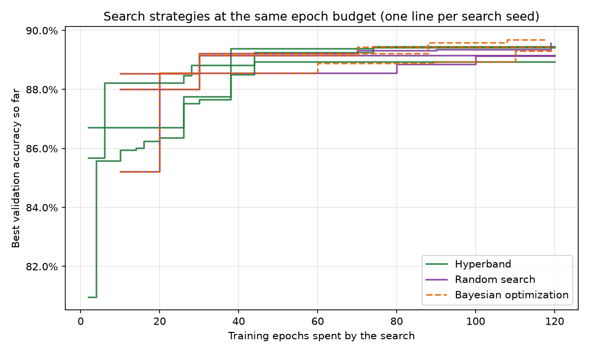

# Hyperparameter Tuning Lab: Keras Tuner on Fashion MNIST

This lab tunes a Fashion MNIST image classifier with [Keras Tuner](https://keras.io/keras_tuner/). It searches the network's depth, width, dropout, learning rate and batch size with **Hyperband**, then compares the tuned model with the lab's hand-picked baseline fairly: both trained the same way, with several seeds, on the test set only at the end. A second command compares Keras Tuner's three search strategies (Hyperband, random search and Bayesian optimization) at the same budget of training epochs.

It is based on the course's hyperparameter tuning lab (`Labs/Model_Development/Hyper_Parameters_Tuning/Keras_Tuner.ipynb`), kept unchanged in [original/Keras_Tuner.ipynb](original/Keras_Tuner.ipynb). This version is a work in progress; the sections below describe it as it stands.

## Prerequisites

| Requirement | Version tested | Install |
|---|---|---|
| Python | 3.12 (TensorFlow 2.21 supports 3.10 to 3.13, not 3.14) | macOS: `brew install python@3.12`; Ubuntu: `sudo apt install python3.12 python3.12-venv`; Windows: [python.org](https://www.python.org/downloads/) |
| Git | any | macOS: `xcode-select --install`; Ubuntu: `sudo apt install git`; Windows: `winget install Git.Git` |

Packages, installed by the setup below from `requirements.txt`:

| Package | Version | Used for |
|---|---|---|
| tensorflow | 2.21.0 | training the models |
| keras | 3.15.1 | the model API |
| keras-tuner | 1.4.8 | the hyperparameter search |
| tensorboard | 2.21.0 | training curves. TensorFlow 2.21 no longer installs it, and Keras's TensorBoard callback fails without it |
| scipy / scikit-learn | 1.18.1 / 1.9.1 | Keras Tuner's `BayesianOptimization` (its optional `bayesian` extra), used by the strategy comparison |
| matplotlib | 3.11.2 | the strategy comparison's plot |

Training runs on the CPU; no GPU is needed. You need about 1.5 GB of disk for the packages, plus 100 MB per run.

## Setup

```bash
git clone https://github.com/Srikarmk/MLOps-Lab5.git
cd MLOps-Lab5
python3.12 -m venv .venv
source .venv/bin/activate          # Windows PowerShell: .venv\Scripts\Activate.ps1
python -m pip install --upgrade pip
pip install -r requirements.txt
```

The install downloads about 280 MB, 220 MB of it TensorFlow, and took 11 minutes here. Check it:

```bash
python -c "import tensorflow as tf, keras, keras_tuner as kt; print(tf.__version__, keras.__version__, kt.__version__)"
```

This should print `2.21.0 3.15.1 1.4.8`.

## Run

```bash
python -m tuning
```

It takes about 10 minutes on a laptop CPU: about 3 minutes of search, then 10 final models (longer if other programs are busy). The first run also downloads Fashion MNIST (30 MB) to `~/.keras/datasets/`. `python -m tuning --quick` checks everything runs in about 25 seconds.

What it does:
1. **Splits the data.** It sets aside 12,000 of the 60,000 training images as a validation set: 20% of each class, always the same images (`tuning/data.py`). The 10,000 test images are only used in step 4.
2. **Searches** with Hyperband (30 trials, at most 10 epochs each), scored by validation accuracy. The search space is `FashionHyperModel` in `tuning/models.py`:

   | Hyperparameter | Values | Notes |
   |---|---|---|
   | `layers` | 1, 2 or 3 hidden layers | |
   | `units_1` … `units_3` | 32 to 512, in steps of 32 | conditional: only exists for a layer the network has |
   | `dropout_1` … `dropout_3` | 0 to 0.5, in steps of 0.1 | conditional, like the units |
   | `learning_rate` | 0.0001 to 0.01 | sampled on a log scale, so each power of ten is equally likely |
   | `batch_size` | 32, 64, 128 or 256 | a training setting, tuned in the hypermodel's `fit()` |
3. **Trains both models the same way**, with 5 seeds each: up to 30 epochs, stopping when validation accuracy hasn't improved for 3 epochs, and keeping the best epoch's weights.
4. **Compares them on the test set**: mean ± standard deviation over the seeds, and the tuned-minus-baseline difference seed by seed, with a 95% interval.

It ends with:

```text
30 trials in 165s. Best (val_accuracy 0.8942): layers=1, learning_rate=0.00121, batch_size=32, units_1=288, dropout_1=0.0
...
==> Results on the test set (5 seeds each)
Baseline  test_accuracy=0.8798 ± 0.0054  (best epoch 11.6 on average)  layers=1, learning_rate=0.001, batch_size=32, units_1=512, dropout_1=0.2
Tuned     test_accuracy=0.8787 ± 0.0046  (best epoch 11.4 on average)  layers=1, learning_rate=0.00121, batch_size=32, units_1=288, dropout_1=0.0
Tuned - baseline: -0.0011, 95% interval [-0.0092, +0.0070]; tuned better with 2 of 5 seeds

Saved runs/<date-time>/results.json
View the training curves: tensorboard --logdir runs/<date-time>/tensorboard
```

Every run is seeded (`--seed`, default 42) and TensorFlow's ops are made deterministic, so the same seed gives exactly these numbers on the same setup. Every search trial also starts from the same random state, so a trial's score depends only on its hyperparameters. Each run writes to its own folder, `runs/<date-time>/`: the tuner's trials, TensorBoard logs and `results.json`. `python -m tuning --help` lists the options (seed, number of seeds, epoch limits).

TensorFlow prints a line starting `E0000 ... NodeDef mentions attribute use_unbounded_threadpool` after training. It is a harmless message from TensorFlow itself.

## Compare search strategies

```bash
python -m tuning.compare
```

This compares Keras Tuner's three search strategies on the same search space, with the same budget of **training epochs**. Trials are not a fair unit, because Hyperband deliberately cuts most of its trials short. It takes about 35 minutes; `python -m tuning.compare --quick` checks it runs in about 40 seconds.

For each of 3 search seeds (42, 10042, 20042):
1. **Hyperband** runs as in the lab, and its hypermodel counts the epochs each trial actually trains: 120 per search.
2. **Random search** and **Bayesian optimization** get the same budget: 12 trials of up to 10 epochs. Bayesian optimization starts with 4 random trials, then lets its model pick the rest.
3. Each search's chosen configuration is **retrained with 3 seeds** the same way as the lab's final models, and scored on validation and test. The baseline is retrained the same way for reference.

The results of the full run are saved in [results/strategy_comparison.json](results/strategy_comparison.json) and [results/strategy_comparison.png](results/strategy_comparison.png). A new run writes its own copy to `runs/<date-time>-compare/`.



Averages over the 3 search seeds:

| Strategy | Trials | Epochs | Search's best validation accuracy | Chosen configuration retrained: validation | Test |
|---|---|---|---|---|---|
| Hyperband | 30 | 120 | 89.27% | 89.77% | 88.72% |
| Random search | 12 | 120 | 89.29% | 90.01% | 88.91% |
| Bayesian optimization | 12 | 119 | 89.48% | 89.85% | 88.63% |
| *Baseline, retrained the same way* | | | | *89.46%* | *88.19%* |

(The retrained scores are higher than the search's because retraining allows up to 30 epochs, against at most 10 in a trial.)

## Results and findings

**From the lab** (`python -m tuning`, one Hyperband search):

| Search space (same budget: 30 Hyperband trials) | Best trial's validation accuracy | Tuned model retrained, 5 seeds: validation | Test | Tuned − baseline on test (95% interval) |
|---|---|---|---|---|
| The original's: width and 3 learning rates | 89.59% | 89.50% | 88.38% ± 0.44 | +0.40 points (−0.15 to +0.95) |
| This version's: depth, width and dropout per layer, learning rate, batch size | 89.42% | 89.00% | 87.87% ± 0.46 | −0.11 points (−0.92 to +0.70) |
| *Baseline, for reference* | | *89.24%* | *87.98% ± 0.54* | |

(The first row was run before every trial started from the same random state, so its search is not exactly reproducible with the current code.)

- **One search beat the baseline by no more than noise.** With the original's two hyperparameters, the search kept the baseline's learning rate and only changed the width. With the larger space, the chosen network (one layer of 288 units, no dropout) is no better than the baseline.
- **The search's own score is optimistic.** The best trial's validation accuracy comes from one training run, and it is the best of 30. Retrained with 5 seeds, the larger space's winner lost 0.42 points of validation accuracy, enough to fall below the baseline.
- **The width the small search picks is luck.** At learning rate 0.001, trials from 96 to 448 units all scored 88.7–89.6% on validation, a range about the size of seed-to-seed variation.
- **One run of each proves nothing.** Across seeds, a single model's test accuracy varies by about ±0.5 points. That's more than the difference the original notebook reported between its baseline and tuned models (0.36 points in one run).
- **10 epochs was too few for the baseline.** Training until validation accuracy stops improving, its best epoch averaged 11.6. The original's fixed 10 epochs cut it short.

**From the strategy comparison** (`python -m tuning.compare`, 9 searches):

- **At this budget, no strategy wins.** The three strategies' average search scores are within 0.21 points of each other, and their retrained test scores within 0.28 points (88.63% to 88.91%). The spread between search seeds of one strategy is larger: Hyperband's three picks score 87.97% to 89.14% on test.
- **Tuning does help a little, and the lab's single search was unlucky.** 8 of the 9 searches picked a configuration that beats the baseline on test, by 0.56 points on average. The lab's own search is Hyperband with seed 42, whose pick was the worst of the nine and the only one below the baseline. One search is as noisy as one training run.
- **The good configurations are deeper, with a lower learning rate.** 8 of the 9 picks have 2 or 3 hidden layers, and random search and Bayesian optimization chose learning rates of 0.0001 to 0.0003, below the baseline's 0.001.
- **Hyperband's short first rounds favour fast learners.** Its picks have learning rates of 0.0004 to 0.0012, higher than every pick of the other two strategies (0.0001 to 0.0003). Hyperband judges most configurations after 2 epochs, where a high learning rate looks best. With seed 42, random search's winner (learning rate 0.000149) was among Hyperband's trials too, scored 86.54% after 2 epochs, and was dropped.
- **Keras Tuner's default Bayesian optimization would have been random search.** By default it starts with 3 random trials per hyperparameter, 27 for this space, more than its whole budget of 12. So it would never use its model, and its trials would be exactly random search's. The comparison sets `num_initial_points=4`.
- **Consecutive search seeds aren't independent.** Keras Tuner draws hyperparameter values from a counter that starts at the seed and goes up by one per draw, so seed 44's draws are seed 42's shifted by two. In a first run with seeds 42, 43 and 44, the 42 and 44 random searches shared 4 of their 12 configurations and picked the same one. The seeds are now 10,000 apart.

## What changed from the original lab

| Problem in the original | Change |
|---|---|
| No package list or versions. TensorFlow 2.21 no longer installs TensorBoard, so **every training run in the notebook crashes**. The notebook still carries on: the baseline is scored untrained (26.4% test accuracy), every search trial fails, `get_best_hyperparameters()` still returns the first trial's random settings as "optimal", and the "tuned" model (86.5%) appears far better than the baseline | Pinned `requirements.txt` that includes TensorBoard. The run checks for it before training, and **a failed trial stops the search** (`max_consecutive_failed_trials=1`). It then refuses to report a best unless every trial finished |
| Rerunning reuses the search saved in `kt_dir/` and silently returns the old result | Each run has its own folder, and the tuner starts fresh (`overwrite=True`) |
| No seeds: results change from run to run | Seeded and deterministic |
| The last cell starts TensorBoard on `/tb_logs`, a folder that doesn't exist | Logs for the baseline, every trial and the tuned model in one folder, with the exact `tensorboard` command printed |
| A notebook run cell by cell | A `tuning` package run with one command, with options for the seed and epochs |
| `validation_split=0.2` inside every `fit`, and a final retrain for a fixed 10 epochs | One fixed, stratified validation set for the search and the final models. The final models train until validation accuracy stops improving and keep their best epoch |
| Baseline and tuned model compared on one unseeded run each | Both trained the same way with 5 seeds, and compared by mean ± spread and a paired 95% interval. The test set is used only for this comparison |
| A model-builder function tuning two hyperparameters: one layer's units and three fixed learning rates | A `HyperModel` subclass tuning the depth (1–3 layers), each layer's units and dropout as **conditional** hyperparameters, the learning rate on a **log scale**, and the **batch size** in its `fit()` |
| Only Hyperband, with no way to tell whether another strategy would do better | `python -m tuning.compare`: Hyperband, random search and Bayesian optimization at the same budget of training epochs, over 3 independent search seeds, with every chosen configuration retrained over 3 seeds |
| Search trials start from whatever random state the previous one left. With the TensorBoard callback, a repeated search sometimes scored trials differently | Each trial reseeds before building its model, so repeated searches match exactly and a configuration gets the same score whichever strategy tries it |
